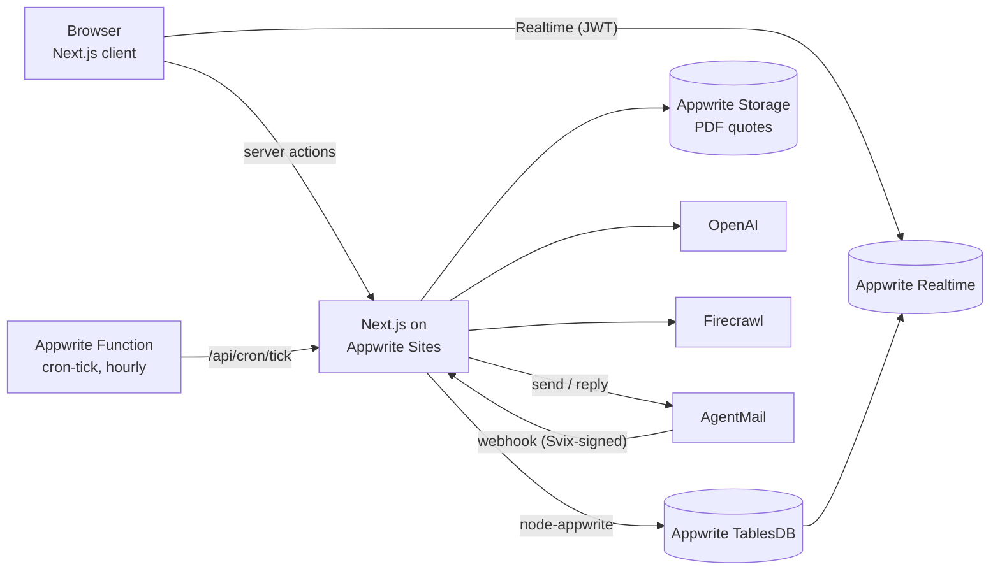

# Quotebook

**A procurement agent built on Appwrite.** A buyer describes what they need in plain
language. Quotebook finds suppliers on the web and emails them for quotes, but only
after the buyer approves each recipient. It reads the replies, including PDF pro-formas,
and lines the answers up on a live comparison board. It then recommends a supplier and
sends the purchase order.

> 50 × Dell Latitude 5550, i7/16GB/512GB, delivered to Kampala within 14 days,
> budget UGX 180,000,000

**Live:** https://quotebook.appwrite.network · Built for the
[Appwrite Hackathon](https://hackathon.appwrite.io) (Oct 19–31, 2026), solo.


---

## What a buyer does

1. **Ask:** types the need. The app reads the items, quantities, budget, currency,
   destination and delivery window.
2. **Find:** the app searches the web, reads each supplier's own page, pulls out a price
   and a contact address, and checks that the address's domain accepts mail (MX lookup).
   Each supplier lands on the board with a *web price*.
3. **Approve:** the send gate shows the exact email and the exact address for each
   supplier. Nothing is sent until the buyer ticks suppliers and clicks, and the server
   accepts at most 5 recipients per send.
4. **Collect & decide:** replies arrive by webhook and are read into *confirmed quotes*
   that supersede the web prices. PDF attachments are stored and read too. Every thread
   is open in a chat panel, and the buyer can answer from inside the app. Suppliers who
   don't reply are followed up after 3 and 7 days. If an address bounces, the RFQ is
   marked bounced and the buyer can supply another address and retry that one supplier.
   A recommendation then names the best offer and the trade-off it accepts.
5. **Award:** the buyer edits a drafted purchase order and sends it on the winning
   supplier's thread. Polite decline emails to the others are optional.

The page updates live as all of this happens, through Appwrite Realtime.

## Architecture



- **The status is the queue.** Every pipeline step (extract, discover, send, parse) reads
  the row's status, does one job and moves the status on. Steps run after the response
  with `after()` from `next/server`, which keeps working past the Sites request timeout
  (measured: 45 s). The hourly Function sends follow-ups and fails requests that
  stalled, so the buyer sees a Retry button instead of an endless spinner.
- **One human checkpoint.** An RFQ's `sent` status is reachable only from `approved`, and
  only a signed-in buyer's action writes `approved`. The 5-recipient cap lives on the
  server.
- **The model reads; arithmetic decides.** OpenAI extracts specs, prices and quotes as
  strict JSON. The recommendation itself is computed deterministically, and the model
  only writes the sentence explaining it. That sentence is not allowed to call the winner
  cheapest when a cheaper offer exists.

## How it uses Appwrite

| Product | Used for |
| --- | --- |
| **TablesDB** | All state: 11 tables, declared in code and created by an idempotent script |
| **Transactions** | Every multi-row change commits together, or not at all |
| **Auth** | Email and password sign-in, with an SSR session in an httpOnly cookie |
| **Realtime** | The request page subscribes to its own `events` rows and refreshes on change |
| **Storage** | PDF quotes, in an encrypted bucket with no public access |
| **Functions** | `cron-tick`: hourly follow-ups and the stalled-request sweep |
| **Sites** | Hosts the Next.js app with SSR |

### Appwrite Databases in detail

The schema is declared once in [`src/lib/db/schema.ts`](src/lib/db/schema.ts) and
applied by [`scripts/setup-db.ts`](scripts/setup-db.ts). The script is idempotent: it
creates whatever is missing, extends enum columns additively and never drops data.

The database enforces the rules instead of the application hoping for them:

- **Unique indexes as correctness guarantees:**
  - `suppliers.domain` is unique, so two discovery runs can never create the same
    supplier twice.
  - `rfqs (requestId, supplierId)` is unique: one RFQ per supplier per request.
  - `inboundParses.eventId` is unique, so a webhook that AgentMail delivers twice is a
    no-op. The 409 on the second insert *is* the idempotency check.
- **Transactions** (`createTransaction`, writes with `transactionId`, then
  `updateTransaction`). Examples:
  - Saving the extracted spec writes the spec and its line items together.
  - Applying a quote reply inserts the emailed quote and marks the crawled one
    `supersededBy` together.
  - Approving a send flips the RFQs, the request status and the audit event together.
  - Awarding a supplier records the purchase order on the request, and the audit
    event, together.
- **Atomic increment as a lock.** Follow-ups are claimed with
  `incrementRowColumn(chaseCount, max)`. If two cron ticks overlap, only one of them can
  claim a given follow-up, so no supplier is emailed twice.
- **Enum state machines:** `requests.status`, `rfqs.status`, `inboundParses.state` and
  `contacts.verification` are enum columns. Every inbound email ends in a named
  terminal state; none is silently dropped.
- **Row security:** every request-scoped row is written with
  `Permission.read(Role.user(ownerId))`. This is also what scopes Realtime: a buyer's
  browser can subscribe to the `events` table and still only ever receive their own rows.
- **Money as integers:** amounts are `bigint` minor units, always stored next to their
  currency, with a foreign-exchange snapshot per run for the USD comparison column.
- **Full-text indexes** on line-item descriptions and supplier names.

| Table | Holds |
| --- | --- |
| `requests` | The buyer's need, the extracted budget, destination and window, plus status and award |
| `lineItems` | One extracted spec line per item |
| `suppliers` | Organisations, shared across requests (unique domain) |
| `contacts` | Addresses per supplier and how far they are trusted (MX checked, bounced) |
| `rfqs` | One quote request per (request, supplier), its mail thread, follow-ups and failures |
| `quotes` | Web prices (crawled) and confirmed quotes (emailed); an emailed quote supersedes, never overwrites |
| `quoteLines` | Per-line pricing under a quote |
| `inboundParses` | Every inbound email and where its reading ended up |
| `recommendations` | The decision, the rationale and the accepted trade-off |
| `attachments` | PDF quotes: metadata here, bytes in Storage |
| `events` | The append-only audit trail per request, and the Realtime signal |

### Security notes

- All writes go through server actions using the API key, and each one checks
  ownership first. Another user's request answers "not found", never "forbidden".
- The browser gets a 15-minute Realtime JWT from a server action. The session cookie
  stays httpOnly.
- Webhooks are verified with Svix signatures on the raw body. Replies that fail
  SPF/DKIM/DMARC are held for human review, never trusted for a price.
- Downloading an attachment is owner-checked: signed-out users get a 401 and anyone
  else a 404.
- Raw provider errors are never shown to buyers. They are logged on the server and
  replaced with plain explanations.

## Tech stack

| Layer | Technology |
| --- | --- |
| Framework | Next.js 16 (App Router, server actions, `after()`), React 19, TypeScript |
| UI | Tailwind CSS v4, shadcn/ui on Base UI, lucide-react, sonner, next-themes |
| Backend | Appwrite TablesDB, Auth, Realtime, Storage, Functions and Sites (`node-appwrite`, `appwrite`) |
| AI | OpenAI (gpt-5, strict JSON outputs) |
| Web search and scraping | Firecrawl (`@mendable/firecrawl-js`) |
| Email | AgentMail (send, threads, replies, attachments, webhooks) |
| PDF text | unpdf |

Bootstrapped from the open-source
[appwrite/starter-for-nextjs](https://github.com/appwrite/starter-for-nextjs) (MIT).

## Running locally

Requirements: Node 20+, an Appwrite Cloud project, and API keys for OpenAI, Firecrawl
and AgentMail.

```bash
cp .env.example .env.local   # fill in the keys (see below)
npm install
npm run db:setup             # creates the database, tables and indexes (safe to re-run)
npm run dev                  # http://localhost:3000
```

| Variable | Purpose |
| --- | --- |
| `NEXT_PUBLIC_APPWRITE_ENDPOINT`, `NEXT_PUBLIC_APPWRITE_PROJECT_ID` | Your Appwrite project |
| `APPWRITE_API_KEY` | Server-only key with database, storage, users and functions scopes |
| `OPENAI_API_KEY`, `FIRECRAWL_API_KEY` | Reading and discovery |
| `AGENTMAIL_API_KEY`, `AGENTMAIL_INBOX_ID`, `AGENTMAIL_WEBHOOK_SECRET` | Sending, and verifying the inbound webhook |
| `CRON_SECRET` | Protects `/api/cron/*`; the `cron-tick` Function sends it as a Bearer token |
| `RFQ_POSTAL_ADDRESS` | Postal address in the RFQ footer, next to the STOP line |

To receive replies, point an AgentMail webhook (`message.received`) at
`https://<your-host>/api/webhooks/agentmail`. To schedule follow-ups, run
`SITE_URL=https://<your-host> npm run fn:deploy`. It deploys `functions/cron-tick` and
sets the Function's `TICK_URL` and `CRON_SECRET` variables.

## Checks

```bash
npm run typecheck
npm run build
```

## License

MIT, see [LICENSE](LICENSE).
